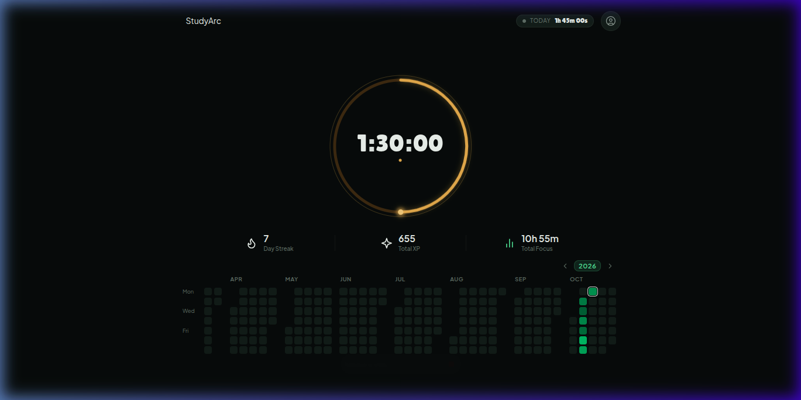
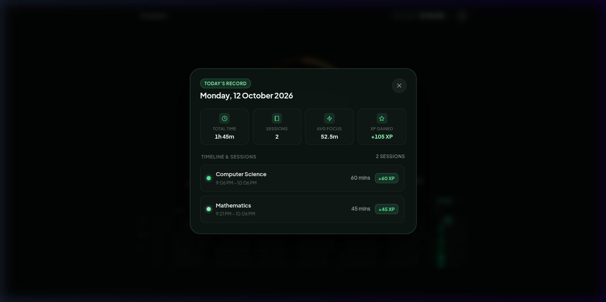
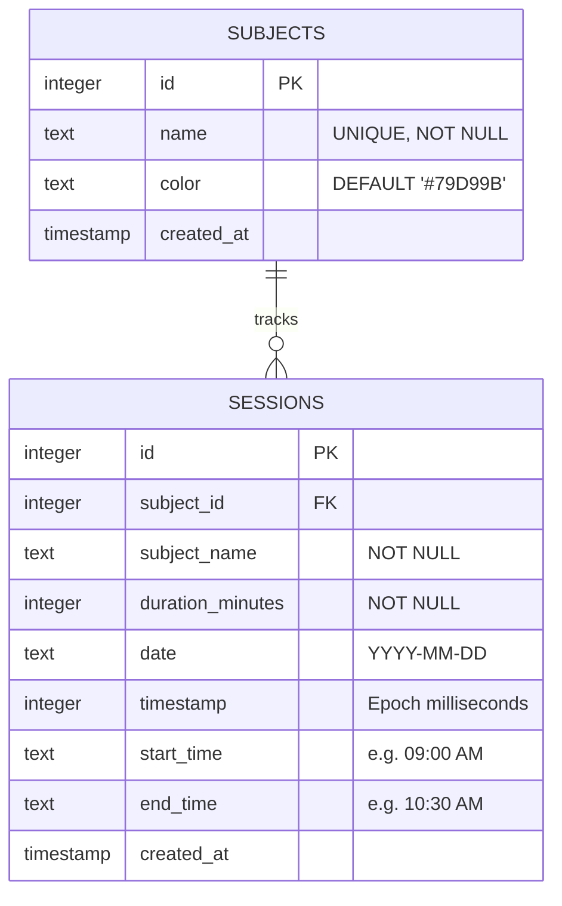

<div align="center">

  # 🌱 StudyArc

  **Minimalist, Gamified Study & Habit Tracker with Kinetic Focus Engine and Multi-Year Activity Heatmap**

  [](https://python.org)
  [](https://flask.palletsprojects.com/)
  [](https://sqlite.org)
  [](https://developer.mozilla.org)
  [](LICENSE)

  <p align="center">
    <a href="#-overview">Overview</a> •
    <a href="#-key-features">Key Features</a> •
    <a href="#-screenshots">Screenshots</a> •
    <a href="#-quickstart">Quickstart</a> •
    <a href="#-rest-api-reference">API Reference</a> •
    <a href="#-database-schema">Database</a> •
    <a href="#-controls--shortcuts">Shortcuts</a> •
    <a href="#-license">License</a>
  </p>

</div>

---

## 🌟 Overview

**StudyArc** is an ultra-focused study and productivity companion built with modern web aesthetics and zero frontend bloat. It combines the tactile satisfaction of an analog dial with the gamified feedback loops of GitHub's contribution graph and RPG-style XP leveling.

Engineered with a centered, distraction-free interface, StudyArc eliminates clutter—no unnecessary sidebars, tabs, or modal traps. Every focus block is persisted in an embedded SQLite database with minute-level precision and chronological timeline tracking.

---

## 📸 Screenshots

<div align="center">
  <h3>Hero Timer & Consistency Heatmap</h3>
  
  <p><em>Centered distraction-free viewport: circular progress arc, live gamification metrics, and multi-year consistency heatmap.</em></p>
  <br/>
  <h3>Day Record Modal & Chronological Timeline</h3>
  
  <p><em>Inspect any day's metrics: 4 highlight summary pills and detailed chronological session logs with "from when to when" time ranges.</em></p>
</div>

---

## ✨ Key Features

### ⏱️ Circular Kinetic Focus Timer
- **Draggable Bead Ring**: Adjust your target focus time anywhere from 1 minute up to 3 hours with a smooth SVG drag gesture.
- **Center-Pad Gestures**: Tap once anywhere inside the circle to start/pause. Press and hold for 2 seconds to smoothly reset.
- **Cinematic Rolling Numerals**: Multi-spin kinetic dial display with sub-pixel blurring and 3D depth-of-field transition effects.
- **Pure Web Audio Synthesizer**: Meditative harmonic chimes (C5 $\rightarrow$ G5 $\rightarrow$ C6 chord) generated algorithmically with Web Audio API—no external audio files required.

### 📅 Multi-Year Consistency Heatmap
- **2025–2026 Historical Timeline**: Seamless horizontal track rendering months chronologically with dynamic year badge tracking.
- **10 Mint & Emerald Intensity Shades**: Cells dynamically scale in color based on minutes studied, with ambient glow effects on peak study days.
- **Fluid Navigation**: Native drag-to-scroll, horizontal wheel snapping, and period navigation controls.

### 📊 Deep Day Chronicle & Timeline Feed
- **Today Live Pill**: A pulsing header badge displaying today's real-time elapsed time. One click opens today's complete dossier.
- **Interactive Heatmap Cells**: Click any cell across 2025 or 2026 to open that exact date's Day Record modal.
- **4 Highlight Summary Pills**:
  1. **Total Time**: e.g., `2h 30m`
  2. **Total Sessions**: Count of completed focus blocks
  3. **Average Focus Time**: Average duration per session (e.g., `75.0m`)
  4. **XP Gained**: Experience points earned on that date
- **"From When to When" Session Breakdown**: Every session displays exact start and end times (e.g., `5:00 PM – 6:30 PM`), duration badge, subject color dot, and earned XP.
- **Rest Day Recognition**: Displays an empty state card for non-study / rest days.

### 💾 Persistent SQLite Architecture
- Lightweight embedded database (`study_tracker.db`) with normalized `subjects` and `sessions` tables.
- Pre-seeded with over **1,100+ authentic sessions across 500+ active days** from January 1, 2025 to October 2026.
- Foreign key constraints, date/timestamp indexes, and automatic schema migrations.

---

## 🚀 Quickstart

### Prerequisites
- Python 3.10+
- Modern web browser (Chrome, Edge, Firefox, Safari)

### 1. Clone the Repository
```bash
git clone https://github.com/AnuragBhaskarya/StudyArc.git
cd StudyArc
```

### 2. Set Up Virtual Environment (Optional but recommended)
```bash
python3 -m venv .venv
source .venv/bin/activate  # On Windows: .venv\Scripts\activate
pip install -r requirements.txt
```

### 3. Launch StudyArc
```bash
python3 server.py
```

### 4. Open in Browser
Visit **[http://localhost:8080](http://localhost:8080)** in your browser.

---

## 📡 REST API Reference

The backend provides a clean RESTful interface for all timer, session, and heatmap operations:

| Method | Endpoint | Description |
|---|---|---|
| `GET` | `/api/state` | Returns entire application state (subjects, recent sessions, daily activity map, and stats). |
| `GET` | `/api/day/<YYYY-MM-DD>` | Returns full breakdown for a specific date (4 summary pills + chronological session array). |
| `POST` | `/api/sessions` | Logs a newly completed focus block. Recalculates streaks and stats in real-time. |
| `DELETE` | `/api/sessions/<id>` | Permanently deletes a focus session by ID and updates stats, heatmap, and day breakdown. |
| `GET` | `/api/subjects` | Retrieves all subjects with aggregate hours and session counts. |
| `POST` | `/api/subjects` | Creates a new subject with custom name and hex color. |
| `GET` | `/api/activity` | Returns date-to-minutes key-value dictionary for the heatmap. |
| `GET` | `/api/stats` | Returns current streak, total XP, and total focus seconds. |
| `POST` | `/api/reset` | Resets or re-seeds the SQLite database (`{"reseed": true}`). |

### Sample: `GET /api/day/2026-10-12`
```json
{
  "success": true,
  "data": {
    "date": "2026-10-12",
    "formattedDate": "Monday, October 12, 2026",
    "isToday": true,
    "totalMinutes": 210,
    "totalTimeFormatted": "3h 30m",
    "totalSessions": 3,
    "avgFocusMinutes": 70.0,
    "totalXp": 210,
    "sessions": [
      {
        "id": "sess_1110",
        "subject": "Linear Algebra",
        "color": "#86EFAC",
        "durationMinutes": 75,
        "timeRange": "9:00 AM – 10:15 AM",
        "startTime": "9:00 AM",
        "endTime": "10:15 AM",
        "xp": 75
      },
      {
        "id": "sess_1111",
        "subject": "Computer Science",
        "color": "#79D99B",
        "durationMinutes": 75,
        "timeRange": "1:30 PM – 2:45 PM",
        "startTime": "1:30 PM",
        "endTime": "2:45 PM",
        "xp": 75
      },
      {
        "id": "sess_1112",
        "subject": "Cognitive Science",
        "color": "#3A965A",
        "durationMinutes": 60,
        "timeRange": "4:00 PM – 5:00 PM",
        "startTime": "4:00 PM",
        "endTime": "5:00 PM",
        "xp": 60
      }
    ]
  }
}
```

---

## 🗄️ Database Schema

StudyArc runs on an embedded SQLite engine with foreign key constraints enabled:



---

## ⌨️ Controls & Shortcuts

| Action | Control | Description |
|---|---|---|
| **Toggle Timer** | <kbd>Space</kbd> or <kbd>Click Center Pad</kbd> | Starts or pauses the active countdown. |
| **Adjust Duration** | <kbd>Drag Bead</kbd> | Move the luminous bead along the circular track (1m to 180m). |
| **Reset Timer** | <kbd>Hold Center Pad (2s)</kbd> | Smoothly resets timer to configured duration. |
| **Open Today Tab** | <kbd>Click Today Pill</kbd> | Opens today's dossier with live session summary. |
| **Inspect Any Date** | <kbd>Click Heatmap Cell</kbd> | Opens that specific day's records and timeline. |
| **Dismiss Modal** | <kbd>Esc</kbd> or <kbd>Click Backdrop</kbd> or <kbd>✕ Button</kbd> | Closes the open Day Record dialog. |
| **Heatmap Scroll** | <kbd>Mouse Wheel</kbd> / <kbd>Drag</kbd> | Smooth horizontal scroll across 2025 and 2026. |

---

## 📁 Repository Structure

```
StudyArc/
├── assets/
│   ├── preview-main.png          # Main interface screenshot
│   └── preview-day-dialog.png    # Day record modal screenshot
├── index.html                    # Semantic HTML5 app structure & SVG timer
├── styles.css                    # Glassmorphic dark design system & tokens
├── app.js                        # Client state engine, SVG bead, and canvas audio
├── database.py                   # SQLite ORM, aggregations & real data generator
├── server.py                     # Lightweight Flask REST server & static router
├── study_tracker.db              # Pre-seeded SQLite database (2025–2026 data)
├── requirements.txt              # Minimal Python dependencies
├── .gitignore                    # Python, OS, and IDE cache exclusions
├── LICENSE                       # MIT License
└── README.md                     # Comprehensive documentation
```

---

## 📄 License

Distributed under the **MIT License**. See [`LICENSE`](LICENSE) for more information.

<div align="center">
  <sub>Crafted with passion for minimalist productivity.</sub>
</div>
